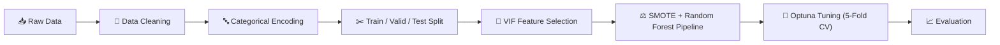

<div align="center">

# 📉 Customer Churn Prediction
### Random Forest + Optuna Hyperparameter Tuning, Optimized for Recall


*Can we catch customers before they leave?*

</div>

---

## 📌 Table of Contents

- [Overview](#-overview)
- [Dataset](#-dataset)
- [Methodology](#-methodology)
- [Hyperparameter Tuning](#-hyperparameter-tuning)
- [Results](#-results)
- [Conclusion](#-conclusion)
- [Tech Stack](#-tech-stack)
- [How to Run](#-how-to-run)
- [Author](#-author)

---

## 🎯 Overview

Customer churn, when customers stop using a company's service, directly hurts revenue. Acquiring a new customer is usually more expensive than keeping an existing one, so being able to **identify customers who are about to leave** is valuable for any subscription-based business.

This project builds a **binary classification model** that predicts whether a customer will churn. Because the business goal is to find as many at-risk customers as possible, **Recall** is used as the primary evaluation metric. A missed churner (False Negative) is a lost customer that the company never had a chance to retain.

**Key highlights:**

- 🌲 **Random Forest** classifier as the base model
- ⚖️ **SMOTE** to handle the imbalanced target, applied *inside* the cross-validation pipeline to avoid data leakage
- 🔍 **VIF analysis** to detect and remove multicollinearity
- 🤖 **Optuna** (200 trials, 5-fold stratified CV) to tune hyperparameters for recall
- 📈 Recall improved from **55.90% → 71.18%** on the validation set (**+27.33%** relative)

---

## 📊 Dataset

| Item | Detail |
|---|---|
| **File** | `churn.csv` |
| **Raw size** | 7,046 rows × 12 columns |
| **Target** | `Churn` (1 = customer churned, 0 = customer stayed) |
| **Problem type** | Binary classification (imbalanced) |

**Features used in the model include:**

| Type | Features |
|---|---|
| Numerical | `Tenure`, `MonthlyCharges`, `TotalCharges` (dropped later due to multicollinearity) |
| Binary categorical | `Partner`, `Dependents`, `PaperlessBilling` |
| Ordinal categorical | `Contract` (Month-to-month < One year < Two year) |
| Nominal categorical | `PaymentMethod` |

**Dropped columns:** `customerID` (just an identifier) and `Gender` (not used for the churn classification objective).

**Initial findings from EDA:**

- The raw data contains **missing values and duplicate rows**.
- The target `Churn` is **imbalanced**, so resampling is needed.
- No extreme outliers were found in the numerical columns based on boxplots.
- `TotalCharges` is right-skewed, and most customers have relatively low total payments.

---

## 🛠️ Methodology



### 1️⃣ Data Cleaning
- Removed unused columns (`customerID`, `Gender`).
- Removed duplicate rows and rows with missing values.
- **167 rows (2.37%)** were removed in total. This is well under 10% and did not noticeably change the `Churn` distribution, so the loss was considered acceptable.

### 2️⃣ Categorical Encoding
Each encoding method was chosen based on the nature of the feature:

| Feature(s) | Method | Why |
|---|---|---|
| `Partner`, `Dependents`, `PaperlessBilling`, `Churn` | **Label Encoding** | Only two categories (0 / 1) |
| `Contract` | **Ordinal Encoding** | Categories have a natural order by contract length |
| `PaymentMethod` | **One-Hot Encoding** | Multiple categories with no meaningful order |

### 3️⃣ Data Splitting
The data was split into three sets so the final test set stays completely unseen during development:

```
Full data ──► 80% pretrain ──► 80% Train (64% of total)
          │                └─► 20% Validation (16% of total)
          └─► 20% Test
```

### 4️⃣ Feature Selection with VIF
Correlation analysis showed several strongly related features:

- `Tenure` ↔ `TotalCharges`: **0.82**
- `Tenure` ↔ `Contract`: **0.67**
- `MonthlyCharges` ↔ `TotalCharges`: **0.65**

The **Variance Inflation Factor (VIF)** confirmed the problem:

| Feature | VIF (before) | Action |
|---|---|---|
| `TotalCharges` | **10.03** | ❌ Dropped |
| `Tenure` | **7.58** → **2.47** after drop | ✅ Kept |

After dropping `TotalCharges`, every remaining feature had a VIF below 5, so multicollinearity was resolved.

### 5️⃣ Model Pipeline
An `imblearn` pipeline was used so that **SMOTE only touches the training portion of each CV fold**:

```python
Pipeline([
    ("smote", SMOTE(random_state=42)),
    ("rf", RandomForestClassifier(random_state=42, n_jobs=-1)),
])
```

> 💡 Applying SMOTE to the whole dataset *before* cross-validation would leak synthetic samples into the validation folds and inflate the scores. Putting it inside the pipeline prevents that.

### 6️⃣ Evaluation Metrics

| Metric | Role |
|---|---|
| **Recall** ⭐ | **Primary metric.** How many real churners did we catch? |
| Precision | How reliable are the churn predictions? |
| F1-Score | Balance between precision and recall |
| Accuracy | Overall correctness |
| Confusion Matrix | Detailed TP / TN / FP / FN breakdown |

---

## 🤖 Hyperparameter Tuning

Tuning was done with **Optuna** over **200 trials**, maximizing the mean **recall** across **5-fold Stratified Cross-Validation** on the training set.

**Search space:**

| Hyperparameter | Range |
|---|---|
| `n_estimators` | 100 – 500 |
| `max_depth` | 5 – 30 |
| `min_samples_split` | 2 – 10 |
| `min_samples_leaf` | 1 – 5 |
| `max_features` | `sqrt`, `log2` |
| `criterion` | `gini`, `entropy` |

**Best parameters found:**

| Hyperparameter | Value |
|---|---|
| `n_estimators` | 439 |
| `max_depth` | 5 |
| `min_samples_split` | 3 |
| `min_samples_leaf` | 4 |
| `max_features` | `log2` |
| `criterion` | `gini` |

---

## 🏆 Results

### Baseline vs Tuned Model (Validation Set)

| Metric | Baseline (default RF) | Tuned (Optuna) | Change |
|---|:---:|:---:|:---:|
| **Recall** | 55.90% | **71.18%** | 🔺 **+27.33%** (relative) |
| True Positives (churners caught) | 161 | **205** | 🔺 +44 |
| False Negatives (churners missed) | 127 | **83** | 🔻 −44 |

Tuning helped the model catch **44 more real churners** on the validation set.

### Final Evaluation (Unseen Test Set)

| Metric | Score |
|---|:---:|
| **Recall** ⭐ | **71.43%** |
| Accuracy | 74.06% |
| Precision | 49.31% |
| F1-Score | 58.34% |

**Test confusion matrix highlights:** out of **350** customers who actually churned, the model correctly identified **250** (True Positives) and missed **100** (False Negatives).

✅ **The test results are consistent with the validation results**, which suggests the model generalizes well and is not overfitted to the validation data.

---

## 📝 Conclusion

- **Tuning worked.** Hyperparameter tuning with Optuna lifted recall from 55.90% to 71.18% on validation, and the model held at **71.43% recall on the test set**.
- **Good data handling mattered.** Cleaning, sensible encoding choices, VIF-based feature selection, and leakage-free SMOTE gave the model a solid foundation.
- **There is a trade-off.** Optimizing for recall makes the model more sensitive, so it flags more customers as churners who would actually have stayed (higher False Positives). This is reflected in the lower precision (49.31%) and accuracy (74.06%).
- **When is this acceptable?** If the cost of losing a customer is higher than the cost of a retention offer sent to someone who would have stayed, favoring recall is a reasonable business decision.

### 🔭 Possible Improvements

- Tune the decision threshold to find a better precision–recall balance
- Try other algorithms (e.g. XGBoost, LightGBM) and compare against Random Forest
- Engineer new features from customer behavior and billing data
- Explore cost-sensitive learning as an alternative to SMOTE

---

## 🧰 Tech Stack

| Category | Tools |
|---|---|
| Language | Python |
| Data handling | pandas, NumPy |
| Visualization | Matplotlib, Seaborn |
| Modeling | scikit-learn (Random Forest, StratifiedKFold) |
| Imbalance handling | imbalanced-learn (SMOTE, Pipeline) |
| Feature selection | statsmodels (VIF) |
| Tuning | Optuna |
| Environment | Google Colab / Jupyter Notebook |

---

## 🚀 How to Run

1. **Clone the repository**
   ```bash
   git clone https://github.com/<your-username>/<your-repo-name>.git
   cd <your-repo-name>
   ```

2. **Install the dependencies**
   ```bash
   pip install pandas numpy matplotlib seaborn scikit-learn imbalanced-learn statsmodels optuna
   ```

3. **Prepare the dataset**
   Place `churn.csv` in the project folder and update the path in the notebook if needed (the original notebook reads from `/content/churn.csv` on Google Colab).

4. **Run the notebook**
   Open the notebook in Jupyter or Google Colab and run all cells in order.

---

## 👤 Author

**Nuh Priyonggo**
Data Science & Machine Learning Student (Batch DSML43)

This project was completed as part of the *Hyperparameter Tuning in Python* assignment.

---

<div align="center">

⭐ If you found this project useful, feel free to give it a star!

</div>
